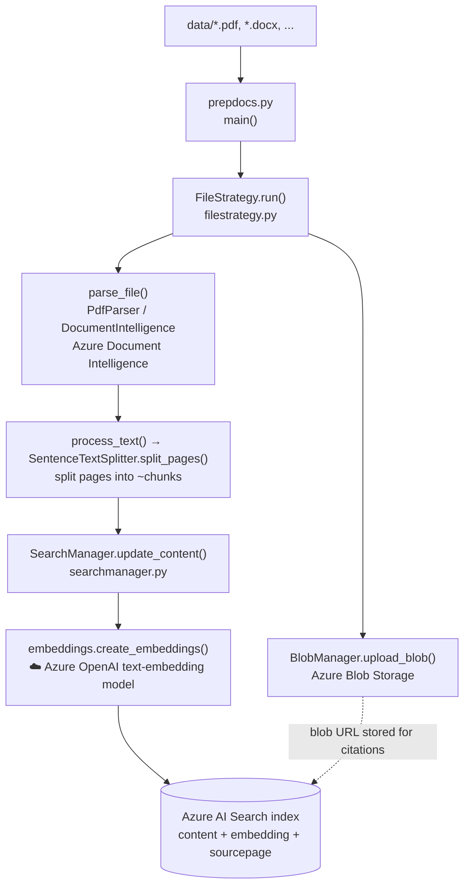
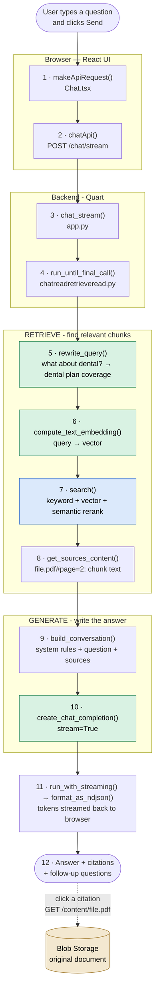
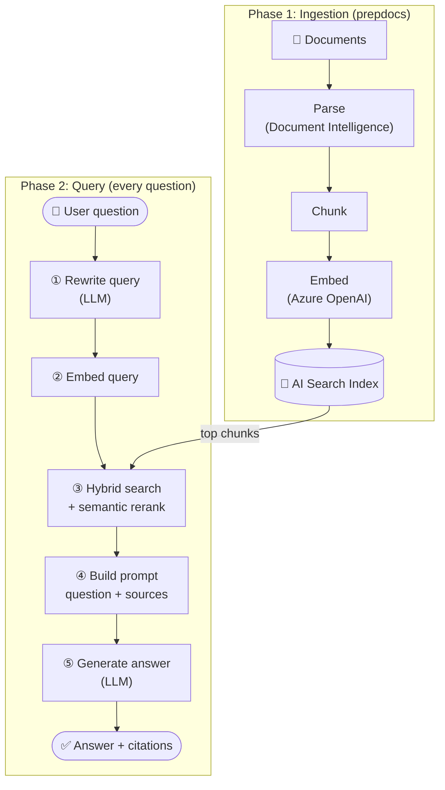

# RAG Chatbot - End to End Flow

How the `azure-search-openai-demo` chatbot works, step by step: which code runs, which Azure service it calls, and why.

> **Viewing the diagrams:** GitHub renders Mermaid automatically or in VS Code, install the **"Markdown Preview Mermaid Support"** extension and press `Ctrl+Shift+V`.

## Summary

### Key scripts and what they do

| Script / file | Phase | Task |
|---------------|-------|------|
| [scripts/prepdocs.ps1](../azure-search-openai-demo/scripts/prepdocs.ps1) | Ingestion | Loads the azd environment and runs `prepdocs.py` on `data/*` |
| [prepdocs.py](../azure-search-openai-demo/app/backend/prepdocs.py) | Ingestion | Entry point: reads config, picks the ingestion strategy (`FileStrategy` by default) |
| [filestrategy.py](../azure-search-openai-demo/app/backend/prepdocslib/filestrategy.py) | Ingestion | For each file: upload → extract text → chunk → index |
| [blobmanager.py](../azure-search-openai-demo/app/backend/prepdocslib/blobmanager.py) | Both | Uploads originals to Blob Storage; later downloads them so citations can open them |
| [textsplitter.py](../azure-search-openai-demo/app/backend/prepdocslib/textsplitter.py) | Ingestion | Splits page text into small, overlapping chunks |
| [searchmanager.py](../azure-search-openai-demo/app/backend/prepdocslib/searchmanager.py) | Ingestion | Creates the index, embeds the chunks (Azure OpenAI) and pushes them into AI Search |
| [app.py](../azure-search-openai-demo/app/backend/app.py) | Query | Quart web server: `/chat`, `/chat/stream`, `/content/<file>` (citations) routes |
| [chatreadretrieveread.py](../azure-search-openai-demo/app/backend/approaches/chatreadretrieveread.py) | Query | Orchestrates the RAG flow for each question |
| [approach.py](../azure-search-openai-demo/app/backend/approaches/approach.py) | Query | Shared helpers: query rewrite, embedding, hybrid search, LLM call |
| [prompts/*.jinja2](../azure-search-openai-demo/app/backend/approaches/prompts/) | Query | Prompt templates (rewrite the query, answer only from sources) |
| [Chat.tsx](../azure-search-openai-demo/app/frontend/src/pages/chat/Chat.tsx) / [api.ts](../azure-search-openai-demo/app/frontend/src/api/api.ts) | Query | React UI: sends the question, renders the answer and citations |

### How an answer is generated

1. **Rewrite:** the LLM turns the question plus the chat history into a standalone search query.
2. **Embed:** that query is converted into a vector with the embedding model.
3. **Retrieve:** Azure AI Search runs hybrid search (keyword + vector) with semantic re-ranking and returns the top chunks.
4. **Augment:** the chunks are put into the prompt together with rules such as "answer only from these sources and cite them".
5. **Generate:** the chat model writes the answer, which is streamed back to the browser with citations and follow-up questions.
6. **Cite:** clicking a citation fetches the original file from Blob Storage via `/content/<file>`.

### Where the prompt is built and the OpenAI model is called

Azure OpenAI is called **twice** for each question: once to rewrite the query and once to generate the final answer. Both calls go through the same helper.

| What | Where | Details |
|------|-------|---------|
| **Search query created** | [chatreadretrieveread.py:364](../azure-search-openai-demo/app/backend/approaches/chatreadretrieveread.py#L364) calls `rewrite_query()` → [approach.py:407](../azure-search-openai-demo/app/backend/approaches/approach.py#L407) | Renders [query_rewrite.system.jinja2](../azure-search-openai-demo/app/backend/approaches/prompts/query_rewrite.system.jinja2) as the system message and calls the LLM with `temperature=0` and the `search_query` tool. The result `query_text` is sent to AI Search. |
| **System instruction created** | [chatreadretrieveread.py:298](../azure-search-openai-demo/app/backend/approaches/chatreadretrieveread.py#L298) calls `prompt_manager.build_conversation()` → [promptmanager.py:27](../azure-search-openai-demo/app/backend/approaches/promptmanager.py#L27) `build_system_prompt()` | Renders [chat_answer.system.jinja2](../azure-search-openai-demo/app/backend/approaches/prompts/chat_answer.system.jinja2): persona, "answer ONLY from the sources", citation format, allowed citations, follow-up questions |
| **User message created** | Same call → [promptmanager.py:42](../azure-search-openai-demo/app/backend/approaches/promptmanager.py#L42) `build_user_prompt()` | Renders [chat_answer.user.jinja2](../azure-search-openai-demo/app/backend/approaches/prompts/chat_answer.user.jinja2): the original question followed by `Sources:` (the retrieved chunks) |
| **Final message list** | [promptmanager.py:66-100](../azure-search-openai-demo/app/backend/approaches/promptmanager.py#L66-L100) `build_conversation()` | `[system, ...past chat history, user (question + sources)]` |
| **OpenAI model invoked** | [chatreadretrieveread.py:317](../azure-search-openai-demo/app/backend/approaches/chatreadretrieveread.py#L317) → [approach.py:975](../azure-search-openai-demo/app/backend/approaches/approach.py#L975) `create_chat_completion()` | `openai_client.chat.completions.create(model=<chat deployment>, messages=..., stream=True, temperature=0.3, max_tokens=1024)` |
| **Model / client configured** | [app.py:418](../azure-search-openai-demo/app/backend/app.py#L418) (`AZURE_OPENAI_CHATGPT_DEPLOYMENT`), [app.py:596](../azure-search-openai-demo/app/backend/app.py#L596) `setup_openai_client()` | The deployment name comes from the azd environment variables |

What the final request to Azure OpenAI looks like (simplified):

```text
[system]  Assistant helps the company employees with their questions about internal documents...
          Answer ONLY with the facts listed in the list of sources below...
          Possible citations for current question: [Benefit_Options.pdf#page=3] ...
[user]    (earlier turns of the chat, if any)
[assistant] ...
[user]    What is included in my dental plan?

          Sources:
          Benefit_Options.pdf#page=3: Northwind Standard covers ... dental ...
          Benefit_Options.pdf#page=4: ...
```

> **Tip:** you can see this exact message list in the app. After an answer, open the 💡 **Thought process** tab and look at the **"Prompt to generate answer"** step, which is recorded at [chatreadretrieveread.py:326](../azure-search-openai-demo/app/backend/approaches/chatreadretrieveread.py#L326).

### Notes

- **Role of Blob Storage:** Blob Storage **stores the original documents for citations**. `prepdocs` pushes the chunks and vectors directly into the index, so the portal shows no indexers or data sources. 
- **Updating the data:** when documents change, run `./scripts/prepdocs.ps1` again. Unchanged files are skipped using their `.md5` hash files. Deleted files must be removed with `prepdocs.py <file> --remove`. If you change the embedding model, recreate the index and delete the `.md5` files.

A RAG app has two separate phases:

1. **Ingestion (offline, run once):** turn your documents into searchable chunks.
2. **Query (online, every question):** find the relevant chunks and let the LLM answer from them.

---

## Phase 1 - Ingestion (`prepdocs`)

Runs when you execute `scripts/prepdocs.ps1` (or during `azd up`).



| # | Step | Code | Service used | Purpose |
|---|------|------|--------------|---------|
| 1 | Entry point | [prepdocs.py:102](../azure-search-openai-demo/app/backend/prepdocs.py#L102) `main()` | — | Reads config, chooses strategy |
| 2 | Loop over files | [filestrategy.py:119](../azure-search-openai-demo/app/backend/prepdocslib/filestrategy.py#L119) `FileStrategy.run()` | — | Orchestrates upload → parse → index |
| 3 | Upload original | [blobmanager.py:423](../azure-search-openai-demo/app/backend/prepdocslib/blobmanager.py#L423) `upload_blob()` | Blob Storage | Keeps the source file so citations can open it |
| 4 | Extract text | [filestrategy.py:21](../azure-search-openai-demo/app/backend/prepdocslib/filestrategy.py#L21) `parse_file()` | Document Intelligence | Turns PDF/DOCX into plain text per page |
| 5 | Chunk | [textsplitter.py:380](../azure-search-openai-demo/app/backend/prepdocslib/textsplitter.py#L380) `SentenceTextSplitter.split_pages()` | — | Small chunks fit into the LLM prompt and match queries better |
| 6 | Embed + index | [searchmanager.py:595](../azure-search-openai-demo/app/backend/prepdocslib/searchmanager.py#L595) `update_content()` | Azure OpenAI embeddings + AI Search | Stores each chunk with its vector so it can be found by meaning, not just keywords |

---

## Phase 2 - Answering a question

Runs every time you press **Send** in the chat UI. Numbers match the reference table below. Colors show which service a step calls: Green colour shows- Azure OpenAI, Blue colour shows- Azure AI Search, White colour shows- plain code.



### Step-by-step reference

| # | Step | Code | Service used | Purpose |
|---|------|------|--------------|---------|
| 1 | User sends question | [Chat.tsx:248](../azure-search-openai-demo/app/frontend/src/pages/chat/Chat.tsx#L248) `makeApiRequest()` | Browser | Collects chat history + settings (overrides) |
| 2 | HTTP call | [api.ts:25](../azure-search-openai-demo/app/frontend/src/api/api.ts#L25) `chatApi()` | — | `POST /chat` or `/chat/stream` |
| 3 | Route handler | [app.py:238](../azure-search-openai-demo/app/backend/app.py#L238) `chat_stream()` | — | Auth check, picks the approach, calls it |
| 4 | Orchestrator | [chatreadretrieveread.py:252](../azure-search-openai-demo/app/backend/approaches/chatreadretrieveread.py#L252) `run_until_final_call()` | — | Runs search pipeline, then builds final prompt |
| 5 | **Query rewrite** | [chatreadretrieveread.py:362](../azure-search-openai-demo/app/backend/approaches/chatreadretrieveread.py#L362) → [approach.py:393](../azure-search-openai-demo/app/backend/approaches/approach.py#L393) `rewrite_query()` | Azure OpenAI (chat) | Turns a follow-up like *"what about dental?"* into a standalone search query using chat history |
| 6 | **Embed query** | [approach.py:879](../azure-search-openai-demo/app/backend/approaches/approach.py#L879) `compute_text_embedding()` | Azure OpenAI (embeddings) | Converts the query into a vector for semantic matching |
| 7 | **Search** | [approach.py:294](../azure-search-openai-demo/app/backend/approaches/approach.py#L294) `search()` | Azure AI Search | Hybrid search (keyword + vector) + semantic re-ranking → top N chunks |
| 8 | Format sources | [approach.py:720](../azure-search-openai-demo/app/backend/approaches/approach.py#L720) `get_sources_content()` | (Blob, only for images) | Produces `"file.pdf#page=2: <text>"` strings and citation list |
| 9 | **Build prompt** | [promptmanager.py:66](../azure-search-openai-demo/app/backend/approaches/promptmanager.py#L66) `build_conversation()` | — | Fills `chat_answer.system.jinja2` (rules: answer only from sources, cite them) and `chat_answer.user.jinja2` (question + sources) |
| 10 | **Generate answer** | [approach.py:934](../azure-search-openai-demo/app/backend/approaches/approach.py#L934) `create_chat_completion()` | Azure OpenAI (chat) | LLM writes the answer grounded in the retrieved chunks |
| 11 | Stream back | [chatreadretrieveread.py:146](../azure-search-openai-demo/app/backend/approaches/chatreadretrieveread.py#L146) `run_with_streaming()` + [app.py:200](../azure-search-openai-demo/app/backend/app.py#L200) `format_as_ndjson()` | — | Sends tokens as they arrive; strips `<<follow-up questions>>` into a separate list |
| 12 | Render | `components/Answer`, `components/AnalysisPanel` | Browser | Shows answer, clickable citations, and the "Thought process" tab |

### Prompt files used

| File | Used in step | What it tells the model |
|------|--------------|-------------------------|
| [query_rewrite.system.jinja2](../azure-search-openai-demo/app/backend/approaches/prompts/query_rewrite.system.jinja2) | 5 | "Generate a search query from the history and question" |
| [chat_query_rewrite_tools.json](../azure-search-openai-demo/app/backend/approaches/prompts/chat_query_rewrite_tools.json) | 5 | Function-calling schema that forces a `search_query` output |
| [chat_answer.system.jinja2](../azure-search-openai-demo/app/backend/approaches/prompts/chat_answer.system.jinja2) | 9 | Persona + "answer ONLY from sources, cite as [file]" |
| [chat_answer.user.jinja2](../azure-search-openai-demo/app/backend/approaches/prompts/chat_answer.user.jinja2) | 9 | The question + the retrieved source text |

---

## Big picture (one diagram)



---

## See it happening live

1. **Thought process tab (easiest):** after any answer, click the 💡 lightbulb icon. It shows the actual rewrite prompt, the generated search query, the raw search results, and the final prompt sent to the LLM - these are the `ThoughtStep`s built in [chatreadretrieveread.py:416](../azure-search-openai-demo/app/backend/approaches/chatreadretrieveread.py#L416).
2. **Supporting content tab:** shows exactly which chunks (step 8) were given to the model.
3. **Breakpoints:** run the backend with the VS Code debugger and set breakpoints at steps 5, 7 and 10 above to inspect `query_text`, `results` and `messages`.
4. **Change a setting and compare:** in ⚙️ Developer settings, switch *Retrieval mode* (text / vectors / hybrid) or turn off the semantic ranker, then ask the same question and compare the Thought process output.
